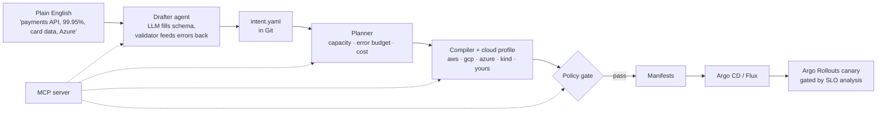

# IntentOps — describe a service once, run it on any cloud

**Write what you want (SLO, traffic, budget, data sensitivity). IntentOps plans the capacity, writes the SLO alerts and the canary gates, prices it on every cloud, checks it against policy, and renders plain Kubernetes manifests for EKS, GKE, AKS, your own bare-metal servers, or kind.**
An AI agent can draft the intent from plain English, and any AI assistant can drive the whole thing over MCP. The model never writes YAML: it fills a typed schema, and a deterministic compiler does the rest.


```yaml
# examples/payments-api.yaml (the whole input)
name: payments-api
team: payments
image: ghcr.io/acme/payments-api@sha256:2c26b4...
cloud: aws
environment: prod
exposure: public
hostname: pay.acme.example
data_classification: pii
slo: {availability: 99.95, latency_p95_ms: 250}
traffic: {peak_rps: 400, rps_per_replica: 80}
resources: {cpu: 500m, memory: 512Mi}
secrets: [stripe-api-key, db-password]
dependencies: [ledger, fraud-check]
budget_usd_month: 400
```

```text
$ intentops plan examples/payments-api.yaml
payments-api (payments) on Amazon EKS, prod:
- runs 4-12 replicas; peak traffic of 400 rps needs 8 at 70% utilisation
- 99.95% over 30 days = error budget 0.050% (21.6 min of full outage)
- pages when the budget burns 14.4x (1h) or 6x (6h) too fast; tickets at 1x over 3d
- releases go 10% -> 50% -> 100% and roll back automatically unless error ratio <= 0.72% and p95 <= 250ms
- estimated $65.55-$196.66/month
- policy: 12 pass, 1 warn, 0 fail

$ intentops compare examples/payments-api.yaml
cloud     replicas   min $/mo  peak $/mo
aws         4-12        65.55     196.66
azure       4-12        64.97     194.91
gcp         4-12        72.12     216.37
kind        4-12         0.00       0.00
```

## How it works



- **Drafter agent.** Turns a request into an intent. The model gets the JSON Schema, its answer is validated by Pydantic (`extra="forbid"`), and validation errors go back to the model until it is right (max 3 tries). Without a model, an offline parser handles the common phrasing and lists every assumption it made.
- **Planner.** Replicas from peak traffic at 70% target utilisation, an HA floor from the SLO (2 replicas at 99.9%, 3 at 99.95%), error budget, multi-window burn-rate thresholds and a monthly cost range.
- **Compiler.** Pure function of intent + profile → manifests. Everything cloud-specific lives in the profile.
- **Policy gate.** Runs on the rendered manifests, so a hand-edited manifest that drifts from the intent still gets caught. `intentops check` exits 1 on any FAIL, which makes it a CI gate.
- **Canary judge.** Statistics decide, the model only explains (see below).

## What one intent becomes

| file | what | why |
|---|---|---|
| `workload.yaml` | Argo Rollout (or Deployment for `release: rolling`) | hardened pod: non-root, read-only root FS, all caps dropped, seccomp; zone spread; no CPU limit (avoids throttling), memory limit = request |
| `analysis.yaml` | AnalysisTemplate | canary error ratio and p95 measured only on canary pods (pod-template-hash), thresholds derived from the SLO |
| `slo-rules.yaml` | PrometheusRule | SLI recording rules + multi-window burn-rate alerts (SRE workbook) + latency alert |
| `hpa.yaml` | HorizontalPodAutoscaler | owns replicas (the workload omits `replicas`, so GitOps sync and the HPA don't fight) |
| `pdb.yaml` | PodDisruptionBudget | node drains and upgrades never take the service below its HA floor |
| `networkpolicy.yaml` | NetworkPolicy | ingress only from the namespace, the gateway and monitoring; `pii`/`confidential` also lock egress to DNS + declared dependencies |
| `externalsecret.yaml` | ExternalSecret | secrets come from the cloud's secret manager, never from Git |
| `httproute.yaml` | Gateway API HTTPRoute | portable routing; the profile names the shared gateway |
| `serviceaccount.yaml` | ServiceAccount | cloud workload identity (IRSA, GKE Workload Identity, Entra Workload ID) |
| `servicemonitor.yaml`, `service.yaml`, `namespace.yaml` | | scraping (with the canary hash label), service, namespace with Pod Security `restricted` |

All 115 rendered resources (2 examples × 5 platforms) pass `kubeconform -strict` against Kubernetes and CRD schemas in CI.

## Deploy it the way your team deploys

The same intent renders to every common Kubernetes delivery style. Tests prove they are equivalent: for every platform, `helm template` of the chart and `kustomize build` of each overlay produce exactly the same objects as the plain manifests.

```bash
intentops render intent.yaml --format all --repo-url https://github.com/acme/gitops.git -o rendered
```

| `--format` | what you get | deploy with |
|---|---|---|
| `helm` | one **versioned chart**: `Chart.yaml` (`version` from `chart_version`, `appVersion` from the image), portable `values.yaml`, `values-<platform>.yaml` for AWS, GCP, Azure, bare metal and kind, `values.schema.json`, `NOTES.txt`, a `helm test` hook | `helm upgrade --install payments-api ./charts/payments-api -n payments --create-namespace -f values-aws.yaml`, `helm rollback` |
| `kustomize` | `base/` with portable defaults + `overlays/<platform>/` with small JSON6902 patches (identity, secret store, spot, spread) | `kubectl apply -k overlays/aws` |
| `manifests` | plain YAML per platform | `kubectl apply -k manifests/aws/payments-api` |
| `argocd` | an Argo CD `Application` per platform: Helm source from your GitOps repo, or pinned to a chart version in an OCI registry (`--chart-repo`) | commit to your GitOps repo |
| `flux` | Flux `GitRepository` (or `OCIRepository` pinned by semver) + `HelmRelease` per platform, with install/upgrade remediation | commit to your Flux repo |

**Chart versioning.** `chart_version` in the intent is the chart's semver. Bump it whenever the intent changes; `helm upgrade` records a new revision, `helm rollback` returns to any earlier one, and the GitHub Action can `helm package` + `helm push` each version to an OCI registry (`chart_registry: oci://ghcr.io/acme/charts`) so Argo CD and Flux deploy an immutable, pinned chart. Each chart also carries an `intentops.io/intent-sha256` annotation, so you can see exactly which intent produced it.

## One intent, every platform: only the lines that must differ do

```diff
$ diff rendered/aws/payments-api/serviceaccount.yaml rendered/azure/payments-api/serviceaccount.yaml
-    eks.amazonaws.com/role-arn: arn:aws:iam::123456789012:role/payments-payments-api
+    azure.workload.identity/client-id: 00000000-0000-0000-0000-000000000000
$ diff rendered/aws/payments-api/workload.yaml rendered/azure/payments-api/workload.yaml
+        azure.workload.identity/use: 'true'
```

| | AWS (EKS) | GCP (GKE) | Azure (AKS) | Bare metal | kind |
|---|---|---|---|---|---|
| identity | IRSA role ARN | Workload Identity GSA | Entra Workload ID | none (Vault Kubernetes auth) | none |
| secrets | Secrets Manager, `team/name/secret` | Secret Manager, `team-name-secret` | Key Vault, `team-name-secret` | HashiCorp Vault, `team/name/secret` | ESO fake store |
| spot for non-prod | `capacityType: SPOT` | `gke-spot` + toleration | `scalesetpriority: spot` + toleration | n/a | n/a |
| price per vCPU-h / GB-h | profile data | profile data | profile data | your amortised hardware cost (example values in the profile) | 0 |

Bare metal means any conformant Kubernetes on your own servers (kubeadm, k3s, RKE2, OpenShift, Talos), with any Gateway API controller (Cilium, Envoy Gateway, NGINX Gateway Fabric) and MetalLB or your own load balancer in front.

### Add a cloud without touching code

A cloud is a YAML file. Drop one in a directory and point `INTENTOPS_PROFILES` at it (tested in `tests/`):

```yaml
# profiles/digitalocean.yaml
name: digitalocean
display: DigitalOcean DOKS
service_account: {annotations: {}}
secret_store: vault
gateways: {public: {name: public, namespace: gateway-system}, internal: {name: internal, namespace: gateway-system}}
zones: 1
spot: null
pricing: {vcpu_hour: 0.03, gb_hour: 0.004, spot_discount: 0}
```

## SLO-gated canaries

The canary thresholds are not magic numbers; they come from the error budget. A canary that would trigger the fast-burn page (14.4× budget) on its own is a failed canary. For 99.95% that is an error ratio of 0.72%.

In the cluster, Argo Rollouts runs the generated AnalysisTemplate every minute and aborts on failure. Outside it, `intentops canary` (and the `analyze_canary` MCP tool) gives a verdict with reasons:

1. too little traffic → **PAUSE**
2. canary above the SLO fast-burn threshold or p95 target → **ROLLBACK**
3. canary errors significantly above baseline (two-proportion z-test, 99%) → **ROLLBACK**
4. weak signal, or p95 >20% above baseline → **PAUSE**
5. otherwise → **PROMOTE**

Exit codes are 0/2/1, so a pipeline can gate on it.

## Policy gate

Pinned image (digest recommended for prod) · HA replicas for 99.9%+ · PodDisruptionBudget · baseline cost within budget (and a warning if peak scale is not) · non-root · hardened container · resource requests · readiness probe · egress lock for sensitive data · warning for public sensitive services · hostname on public routes · canary for prod 99.9%+ · secrets are references, not values.

## Quick start (no cluster, no API key)

```bash
pip install -e ".[dev]"
make demo     # draft from English, plan, compare clouds, render for all clouds into out/
make test     # 44 tests (helm/kustomize equivalence ones need helm and kustomize on PATH)
```

With a model (any OpenAI-compatible endpoint, including Ollama locally):

```bash
export INTENTOPS_LLM=openai INTENTOPS_LLM_BASE_URL=http://localhost:11434/v1 INTENTOPS_MODEL=qwen2.5:7b
intentops draft "internal ledger service for the finance team on GKE, 99.9%, 150 rps, confidential data" -o intents/ledger.yaml
```

## Full lab on kind (free, local)

```bash
make up            # Argo Rollouts, kube-prometheus-stack, External Secrets, Gateway API CRDs, metrics-server
                   # then renders examples/podinfo-kind.yaml and applies it
make release-good  # canary 10% -> 50% -> 100%
make release-bad   # podinfo random-error mode: AnalysisRun fails, Argo Rollouts rolls back
kubectl -n demo get rollout,analysisrun -w
```

## Use it in any repo (GitHub Action)

```yaml
- uses: debanjan0212/intentops@v1
  with:
    intents: "intents/*.yaml"
    cloud: all            # or aws / gcp / azure / your own profile
    profiles: platform/profiles
```

The job summary gets the policy table and the plan for every intent, and the job fails on any policy FAIL. Inputs are passed through env, not interpolated into the script.

## Use it from an AI assistant (MCP)

```json
{"mcpServers": {"intentops": {"command": "intentops", "args": ["mcp"]}}}
```

Tools: `list_clouds`, `draft_intent`, `plan_service`, `check_policy`, `render_manifests`, `compare_clouds`, `analyze_canary`. All are pure (marked `readOnlyHint`): they compute and return, they never apply anything. Ask your assistant "what would a 99.99% version of payments-api cost on GCP?" and it answers from the planner, not from a guess.

## Design decisions

- **The model fills a schema, it never writes YAML.** LLMs are good at intent and bad at 400 lines of exact YAML. Typed schema + validation loop + deterministic compiler gives the flexibility of an agent with the repeatability of a template.
- **Cloud differences are data.** Profiles carry identity annotations, secret stores, gateways, spot labels and prices. New cloud, new region pricing or a company-specific setup = one YAML file.
- **SLOs drive everything downstream.** Replicas floor, PDB, alert thresholds and canary gates are all derived from the same availability number, so they can't disagree.
- **Stats decide, models explain.** A promote/rollback decision must be reproducible and auditable, so it is a z-test and SLO thresholds. The model only writes the explanation.
- **Prices are estimates.** Profile prices are approximate list prices for a US region. Update them for your region and discounts; the point is the comparison and the budget gate.

## Pairs with Argus

[Argus](https://github.com/debanjan0212/argus-sre-agent) is the ops-side agent: it investigates alerts and proposes fixes as PRs. IntentOps generates the SLO alerts Argus responds to and the canaries that stop bad releases before Argus ever gets paged.

## Repo layout

```text
intentops/
  schema.py       the intent (Pydantic, strict)
  plan.py         capacity, error budget, burn rates, cost; profile loading
  compiler.py     intent + profile -> manifests
  policy.py       policy gate
  canary.py       canary judge (z-test + SLO thresholds)
  agent.py        drafter (LLM + self-correction, offline parser) and explainer
  mcp_server.py   MCP tools
  packaging.py    helm chart, kustomize overlays, argocd and flux outputs
  chart_templates/ the generic Helm chart templates (values carry everything)
  cli.py          draft | plan | check | render | compare | canary | mcp
  profiles/       aws, gcp, azure, baremetal, kind
examples/         payments-api (prod, pii, public), podinfo-kind (lab)
deploy/kind/      platform pieces for the local lab
action.yml        reusable GitHub Action
```

## Roadmap

- `intentops diff`: show what changes in the cluster when an intent changes
- Cost from live usage (OpenCost) next to the estimate
- Profiles for OpenShift and OCI

## License

MIT
